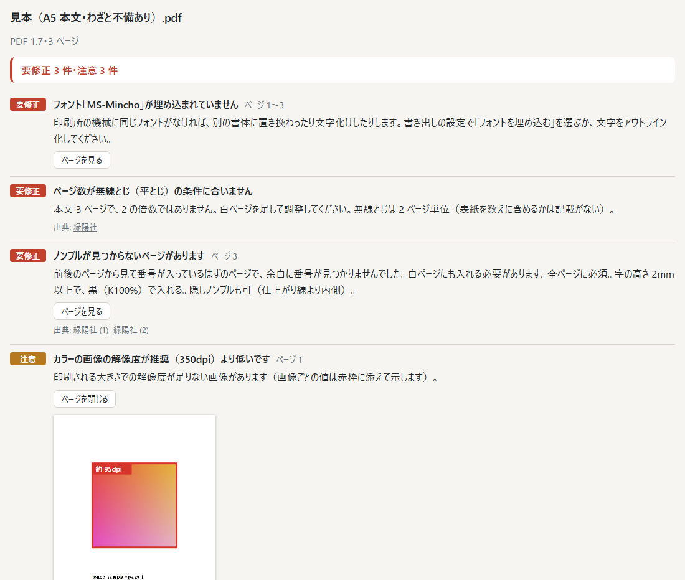
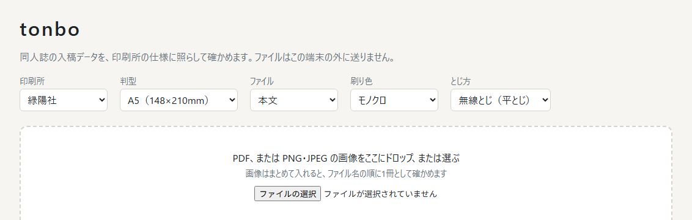
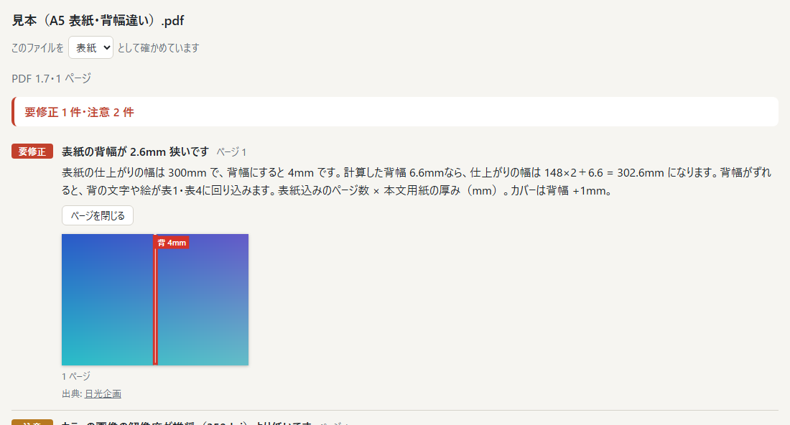
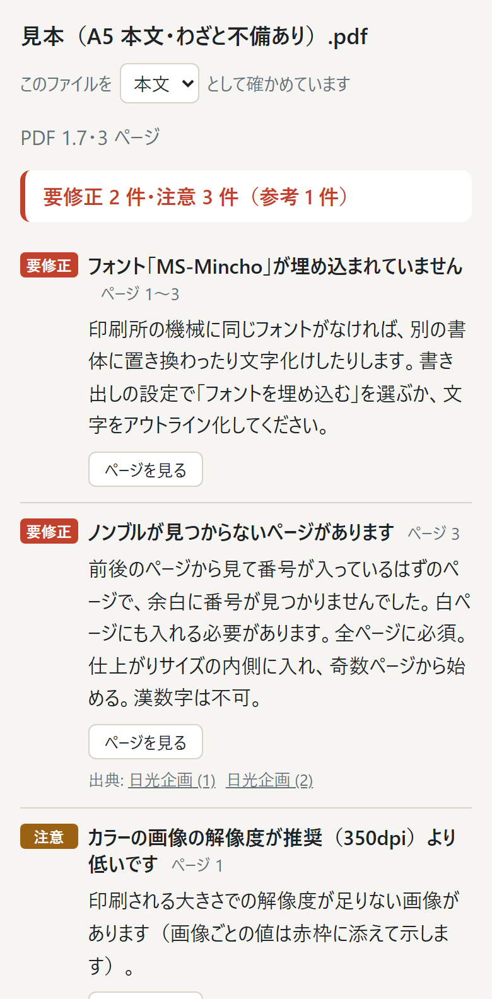

# tonbo

同人誌の入稿データ（PDF・PNG・JPEG）を、印刷所の仕様に照らしてブラウザの中だけで確かめるチェッカー。

**アプリ:** https://tame0522works-art.github.io/tonbo/ （PC とスマホのブラウザで、開くだけで使える。「本文の見本で試す」「表紙の見本で試す」で、わざと不備を入れた PDF をすぐに試せる）



入稿データはどこにも送らない。ファイルの読み取りも判定も、ページの表示も、すべて端末の中で行う。
公開版は Content Security Policy で通信そのものを禁止していて、仮に送信処理が紛れ込んでもブラウザが拒否する。

## できること

| 印刷所と判型を選ぶ | 表紙の背幅のずれ | スマホ |
|---|---|---|
|  |  |  |

- **4社の仕様で確かめる**: 日光企画・緑陽社・ポプルス・しまや出版。どの指摘にも、根拠にした公式サイトのページへのリンクを付ける
- **本文で見るもの**: 仕上がりサイズと塗り足し、画像の実効解像度（印刷される大きさでの dpi）、RGB の使用、フォントの埋め込み、ページ数の単位、ノンブル（ページ番号）の抜けと並び
- **表紙で見るもの**: 本文の用紙とページ数から印刷所の式で背幅を計算し、表紙（表4・背・表1）の幅が合うか
- **指摘の場所を示す**: 「ページを見る」で該当ページを描き、解像度の足りない画像・RGB の画像・背の位置などに赤枠を重ねる
- **重さを3段階で示す**: 要修正（印刷所が不備とするもの）・注意（仕上がりが期待と変わるおそれ）・参考。同じ指摘はページをまとめて1件にする（80ページの本で同じ指摘が80件並ばない）
- **画像の原稿も確かめる**: PNG・JPEG はまとめて入れると、ファイル名の順（`2.png` は `10.png` より前）に1冊として確かめる

## 作りの要点

### 印刷所の仕様は、出典付きのデータとして持つ

仕様は印刷所ごとの JSON（[`src/specs/`](src/specs/)）にし、すべての値に「公式サイトのどのページに書かれていたか」を持たせた。
`npm run check` の中で、出典のない値・どこからも使われない出典・公式サイト以外の URL がないことを確かめている。
公式サイトに書かれていない値は入れない。推測で埋めると「その印刷所の仕様」として誤って伝わるため。

調べてみると、4社の仕様は思ったより食い違っていた（[`docs/specs-research.md`](docs/specs-research.md)）。判定の作りはこの食い違いに合わせた。

- **RGB の扱いが正反対。** 緑陽社とポプルスは RGB のまま入稿するよう勧めていて、日光企画（オフセット）としまや出版は CMYK に変換する。「RGB なら一律に不備」とはせず、印刷所ごとに「注意」と「参考」を出し分ける。モノクロ本文とフルカラー（表紙・カラー本文）でも扱いを分けた。
- **新書の寸法が4社とも違う**（日光企画 105×175、緑陽社 114×182、ポプルス 107×175、しまや出版 107×172 mm）。判型の名前から寸法を決めず、印刷所ごとに持つ。日光企画だけはサイトに寸法がなかったので、配布している本文テンプレート（PSD）のガイド線を読んで決めた。
- **最低解像度はどの社も書いていない。** 推奨値を下回っても「注意」にとどめ、「200dpi 以上なら印刷はできる」のように下限を書いている社だけ、下限を割ったかどうかも分けて伝える。
- **背幅の式がばらばら。** 次の3通りの形で表した。しまや出版は計算できないので、早見表へ案内して背幅を手入力してもらう。
  - 日光企画: 表紙込みページ数 × 用紙の厚み
  - 緑陽社: 0.05 × 本文ページ数 × 紙係数 + 0.4
  - ポプルス: 全ページ数 ÷ 係数
  - しまや出版: 早見表だけ
- **ノンブルの決まりも違う。** 日光企画は奇数ページ始まり・漢数字不可、緑陽社は高さ 2mm 以上、ポプルスは「ファイル名で順番がわかれば不要」。

### PDF の構造は自前で読む

検査に要るのは、ページの枠（MediaBox・TrimBox・BleedBox）、使われたフォント、画像の画素数・色空間と置かれた大きさ、塗りの色だけ。
これを読むために、PDF の字句・相互参照表（表形式と stream 形式、追記の `/Prev`、ObjStm）・圧縮の展開を自前で書いた（[`src/pdf/`](src/pdf/)）。
描画命令は `q`/`Q`（状態の保存と復元）・`cm`（座標変換）・`Do`（画像や部品の配置）・色の指定など、必要な演算子だけを解釈し、画像の実効解像度は「画素数 ÷ ページ上に置かれた大きさ」で求める。部品（Form XObject）の中の画像やインライン画像も追う。
画像の中身は展開しないので、40MB の漫画原稿でも構造の読み取りは数 ms で終わる（下の「検査の実測」）。

手元の PDF 14件で試したところ、2件が「0ページ」と読まれた。相互参照表の位置がずれていて、Root のはずの場所で別のオブジェクトを読んでいた。
そこで開くときに、表のすべての位置が「その番号の obj」で始まっているかを確かめ、ずれていればファイル全体から `n 0 obj` を探して表を組み直すようにした。組み直したときは、印刷所の機械で開けない恐れがあるので「注意」として伝える。

スキャンした PDF（Adobe Scan）では、埋め込みのないフォント4つを「要修正」、RGB の色指定391回を「RGB が使われている」としていた。どちらも、スキャン画像に重ねた検索用の透明な文字（表示モード 3）のもので、印刷されない。
文字の表示モード（`Tr`）を `q`/`Q` とともに追い、フォントは見える文字を描いたときに、RGB は色を選んだときではなく実際に塗った・線を引いた・文字を描いたときに数えるようにした。

保護（暗号化）のかかった PDF は文字列と stream の中身が暗号になっていて読めないので、相互参照表に `/Encrypt` があれば読み進めず、セキュリティを外して書き出し直すよう伝える。

### ページの表示とノンブルの文字だけ pdf.js を使う

ページを描くことと、ノンブルを探すための文字の取り出しには pdf.js を使う。どちらも日本語フォントの扱いまで含めると自前で書く量が大きすぎるため。

公開版は CSP で fetch を禁止しているが、pdf.js は埋め込みのない日本語フォントの文字の対応表（CMap）を fetch で読みに行く。
CMap（169ファイル）はビルド時に1つずつ JS のモジュールにし（[`vite.config.ts`](vite.config.ts) の `bcmapAsModule`）、使う分だけ動的 import で読ませた。動的 import は `script-src 'self'` の範囲なので、CSP を緩めずに済む。

描画は印刷用の intent（`intent: 'print'`）で行う。印刷されない注釈やレイヤーを出さず、刷られるとおりに見せるため。
もう一つ理由があり、画面用の描画は時間のかかるページを `requestAnimationFrame` で分けて進める。そのため、タブが裏に回っていると途中で止まる（埋め込みのない日本語フォントのページで、表示が終わらない現象として見つかった）。印刷用の描画はこれを待たない。

### ノンブルは「番号 − ページの順番」の多数決で探す

仕上がりの端から 25mm 以内にある「数字だけの文字列」を候補にし（全角数字や `- 3 -` のような飾りも読む）、「候補の番号 − ページの順番」で最も多い差を基準にする（[`src/check/nombre.ts`](src/check/nombre.ts)）。
3ページ目から始まる本でも基準が決まり、基準から外れるページを「抜け」「番号違い」として示す。本文中の数字は長い文字列の一部なので拾わない。

文字を画像にした原稿（漫画など）は文字が取れない。半分以上のページで候補が見つからなければ、ページごとの「抜け」を並べず、「確かめられませんでした」の1件にとどめる。
手元の小説の原稿（82ページ・41ページ）では全ページで見つかり、誤った指摘はなかった。市販のシナリオ集（56ページ）では、番号のない表紙側と巻末のページを正しく「なし」とした。

### 画像原稿は、解像度の情報を鵜呑みにしない

PNG・JPEG はヘッダだけを読み（[`src/raster/inspect.ts`](src/raster/inspect.ts)）、PDF と同じ「ページの事実」にして同じ判定にかける。
書き出しソフトによっては、350dpi で作っても解像度の情報に 72dpi と書く。その値で求めた大きさが判型に合わないときは、縦横比が「塗り足し込み」か「仕上がり」に合うかを見て、合えばその大きさで刷るとみなして解像度を逆算する（そうしたことは「参考」として伝える）。
どちらでも合わなければ「大きさが合わない」の1件だけを出し、PDF 用の大きさの指摘は重ねない。

### 通信をブラウザに禁止させる

「送る処理を書いていない」だけに頼らず、公開版の HTML に CSP を入れて、ブラウザに通信そのものを拒否させている（[`vite.config.ts`](vite.config.ts)）。

```
default-src 'none'; script-src 'self'; style-src 'self'; font-src 'self'; img-src 'self';
connect-src 'none'; worker-src 'self'; base-uri 'none'; form-action 'none'; object-src 'none'
```

見本の PDF も fetch では読めないので、ビルド時に JS へ埋め込んでいる。画像原稿は `createImageBitmap` で Blob から直接描き、blob: の URL も使わない。
wasm は CSP の `'wasm-unsafe-eval'` が要るので、pdf.js でも使わない（JPEG 2000 などは JS の実装で読む）。
GitHub Pages はレスポンスヘッダーを設定できないので `<meta>` で入れている。開発サーバーは更新の通知に WebSocket を使うので、ビルドのときだけ入れる。
公開と同じ設定のビルドで、PDF・画像原稿の検査、ページの表示、埋め込みのない日本語フォントのページの描画が、違反なく動くことを確かめた。

## 検査の実測

2026-10-14、AMD Ryzen 7 5700X ／ Node.js 24（`npm run bench`）。
手元の原稿は載せられないので、同じ形の PDF をスクリプトで組み立てて測った（[`tools/bench.ts`](tools/bench.ts)、毎回同じ中身）。1回空打ちしたあと5回測った中央値（カッコ内は最小〜最大）。

| 原稿 | ファイル | 構造の読み取り | 文字の取り出し（pdf.js） | 判定 |
|---|---|---|---|---|
| 小説 A5 100ページ | 40 KB | 25 ms（20〜38） | 74 ms（70〜81） | 1 ms |
| 小説 A5 300ページ | 118 KB | 45 ms（40〜49） | 250 ms（216〜332） | 3 ms |
| 漫画 A5 40ページ（画像 1MB × 40） | 40.0 MB | 2 ms（1〜2） | 23 ms（18〜30） | 0 ms |

- **画像の多い原稿でも、構造の読み取りはほぼ一瞬。** 画像の中身を展開せず、相互参照表と辞書だけをたどるため。
- **時間の大半は pdf.js での文字の取り出し**（ノンブルの検査のため）。300ページで約 0.25 秒。
- **描画命令の多い PDF は読み取りに時間がかかる。** 手元の市販のシナリオ集（22MB・56ページ・画像146枚・書体33・描画命令 7.25MB）では、はじめ 1.14 秒かかっていた。字句の読み取りで、1語ごとに部分配列から文字列を作っていたのが3分の1を占めていた。1文字ずつつなぐ形と、区切り文字の判定の表引きに変えて、0.37 秒になった。

## 残っている課題

- **印刷所の仕様は 2026-10-14 時点のもの。** 仕様が変わっても自動では追いつかない。画面には「非公式のチェックで、入稿の前に印刷所の最新の案内を確かめてほしい」と出している。
- **実際の入稿データでの試用はまだ。** 確かめたのは、組み立てた PDF・見本・手元の PDF 14件（小説の原稿、市販のシナリオ集、チラシなど）。お絵描きソフト（CLIP STUDIO PAINT など）が書き出した漫画原稿や、トンボ付きの PDF では試せていない。
- **目次のページで、目次の数字をノンブルと取り違えることがある。** 余白に近い目次の番号（例:「52」）を拾い、「番号が並びと合わない」と出る（市販のシナリオ集で確認）。
- **見ていないもの**: 総インク量（日光企画の PP 加工時の 350% 以下など）、黒の作り方（K100% かリッチブラックか）、ノンブルの位置の細かい決まり（ノドから 6mm など）、見開きの PDF、カバー、PSD・TIFF。
- **実機では確かめていない。** 確かめたのは PC の Edge・Chrome と、Chrome でスマホの画面を再現したものだけ。

## 開発

```bash
npm install
npm run dev           # http://localhost:5191/（ほかの作品と重ならないよう、ポートを固定している）
```

```bash
npm run check         # PDF の読み取り・ページの事実・仕様データ・判定・ノンブル・画像原稿を検証
npm run build
npm run preview       # 公開と同じ設定（CSP 入り）のビルドを http://localhost:5192/ で配信する
npm run screenshots   # README の画像を撮り直す（npm run preview を起動しておく）
npm run bench         # 検査の実測
npm run samples       # 見本の PDF（src/samples/）を作り直す
```

`npm run check` の確認では、PDF をバイト単位で組み立てて使う（[`tools/pdf-builder.ts`](tools/pdf-builder.ts)）。表形式と stream 形式の相互参照表、追記、位置のずれた表、Length の誤った stream など、実在の作成ソフトが出す形を再現している。

`main` に push すると、GitHub Actions が lint・検証・ビルドを通したうえで GitHub Pages に公開する（[`.github/workflows/pages.yml`](.github/workflows/pages.yml)）。

README の画像は [`tools/screenshots.ts`](tools/screenshots.ts) で撮っている。Edge（なければ Chrome）を画面なしで起動し、Chrome DevTools Protocol で見本を開いて指摘のページを開くまでを毎回同じ手順で行う。普段のブラウザのデータには触れない（一時プロファイルを使い、終わったら消す）。

## 使っているもの

- [pdf.js](https://github.com/mozilla/pdf.js)（Apache License 2.0）… ページの表示と文字の取り出し
- 印刷所の名前と仕様は、各社の公式サイトに書かれていたものを、出典を付けて引いている。tonbo は各社とは関係のない非公式のツール。
